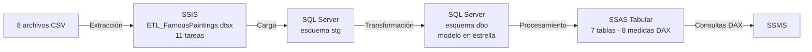
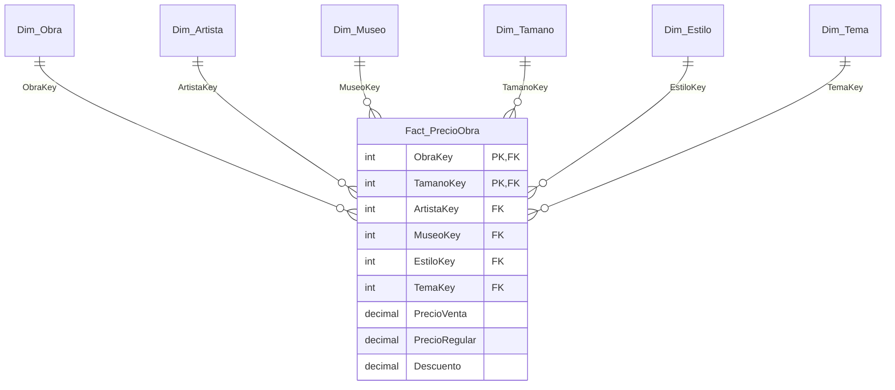

# Data Warehouse Famous Paintings — SQL Server, SSIS y SSAS

Data warehouse construido de punta a punta con el stack de Microsoft a partir de 8 archivos CSV sobre obras de arte, artistas, museos y precios de reproducciones. Incluye un proceso ETL en SSIS, un modelo en estrella en SQL Server, validación de la carga con scripts T-SQL y un modelo tabular en SSAS con medidas DAX.

**Herramientas:** SQL Server 2019 · SSIS (Visual Studio 2022) · SSAS 2019 Tabular · SSMS · T-SQL · DAX

## Arquitectura



La base `DW_FamousPaintings` tiene dos esquemas:

- **`stg` (preparación):** recibe los CSV tal como vienen. Todas las columnas son de texto para que valores problemáticos (por ejemplo `#VALUE!`) no detengan la carga.
- **`dbo` (modelo):** contiene solo el modelo en estrella.

## Modelo en estrella



- **Grano de la tabla de hechos:** una fila por cada obra ofrecida en un tamaño de lienzo. La clave primaria compuesta `(ObraKey, TamanoKey)` impide filas repetidas.
- **Dimensiones:** Obra, Artista, Museo, Tamaño, Estilo y Tema, cada una con clave sustituta (`IDENTITY`) y el código original del CSV para mantener la trazabilidad.
- **Integridad:** llaves foráneas en todas las relaciones e índices en las claves más usadas para filtrar.

## Proceso ETL (SSIS)

El paquete `ETL_FamousPaintings.dtsx` tiene 11 tareas y se puede volver a ejecutar completo:

1. Vaciar las tablas de staging.
2. **Flujo de datos:** cargar los 8 CSV en las 8 tablas `stg`.
3. Vaciar el modelo en estrella.
4. a 9. Transformar y cargar las 6 dimensiones (Artista, Museo, Tamaño, Estilo, Tema y Obra).
10. Registrar las filas de precios con errores en `stg.ErroresPrecio`.
11. Cargar la tabla de hechos `Fact_PrecioObra`.

### Reglas de limpieza

- Eliminación de duplicados: 60 obras repetidas y 687 combinaciones obra-tamaño repetidas.
- Corrección de errores de origen, como el día `Thusday` en los horarios de museos y países y ciudades mal registrados.
- Miembros por defecto (`Sin museo`, `Sin estilo`, `Sin tema`) para no perder obras con datos faltantes.
- **Las filas inválidas no se borran:** los 328 precios asociados a un tamaño inexistente se guardan en `stg.ErroresPrecio` con su motivo y fecha.
- Cálculo del descuento (`PrecioRegular - PrecioVenta`).

## Resultados de la carga

| Tabla | Filas | Nota |
|---|---:|---|
| `Fact_PrecioObra` | 109.332 | 110.347 de origen − 687 duplicados − 328 errores |
| `Dim_Obra` | 14.716 | obras únicas |
| `Dim_Artista` | 421 | |
| `Dim_Museo` | 58 | 57 museos + "Sin museo" |
| `Dim_Tamano` | 200 | |
| `Dim_Estilo` | 24 | 23 estilos + "Sin estilo" |
| `Dim_Tema` | 152 | 151 combinaciones + "Sin tema" |
| `stg.ErroresPrecio` | 328 | precios con tamaño inválido |

## Validación

El script `SQL/02_Validacion_DW.sql` compara cada resultado con el valor esperado, calculado previamente desde los CSV:

- Estructura: 1 tabla de hechos y 6 dimensiones.
- Conteos de staging iguales a los de los archivos de origen.
- Conteos del modelo en estrella iguales a los esperados.
- 0 duplicados en el grano de la tabla de hechos.
- 0 llaves foráneas sin correspondencia.
- Reglas de limpieza aplicadas (0 descuentos negativos, 0 ciudades numéricas, etc.).

Además, la consulta DAX de `SSAS/03_Prueba_DAX_SSAS.dax` devuelve los mismos totales que SQL (109.332 ofertas), lo que confirma que el modelo tabular quedó bien construido.


## Modelo tabular (SSAS)

Proyecto `SSAS_FamousPaintings` con las 7 tablas, 6 relaciones y 8 medidas DAX: Ofertas, Obras, Precio Venta Promedio, Precio Regular Promedio, Precio Venta Mínimo, Precio Venta Máximo, Descuento Promedio y % Descuento.


**Ejemplo de hallazgo:** el Impresionismo es el estilo con más oferta (24.506 ofertas de 3.075 obras), seguido del Postimpresionismo y el Realismo.

## Cómo reproducirlo

1. **SQL Server:** en SSMS, ejecutar `SQL/01_Crear_DW_FamousPaintings.sql` para crear la base, los esquemas y las tablas.
2. **SSIS:** abrir `SSIS/SSIS_FamousPaintings.sln` en Visual Studio, actualizar la ruta de la carpeta `Famous Paintings` y el servidor en los administradores de conexión, y ejecutar el paquete.
3. **Validación:** ejecutar `SQL/02_Validacion_DW.sql` en SSMS.
4. **SSAS:** abrir `SSAS/SSAS_FamousPaintings/SSAS_FamousPaintings.sln`, ajustar el servidor, desplegar y procesar el modelo.
5. **Prueba DAX:** conectarse a Analysis Services en SSMS y ejecutar `SSAS/03_Prueba_DAX_SSAS.dax`.

## Estructura del repositorio

```
Famous Paintings/          8 archivos CSV de origen
SQL/                       creación del DW y validación
SSIS/                      proyecto y paquete ETL
SSAS/                      modelo tabular y prueba DAX
Diagramas/                 diagramas en PDF y sus fuentes Mermaid
Documentacion/             documentación y justificación de herramientas
evidencias en capturas/    capturas de cada etapa
```

## Fuente de los datos

Dataset "Famous Paintings" de Kaggle: <!-- PEGAR AQUÍ EL ENLACE DEL DATASET -->

---

Autora: **Alison Nahomy Mcfarlane** · Proyecto del Técnico en Data Engineer, Universidad Cenfotec.
